<div align="center">

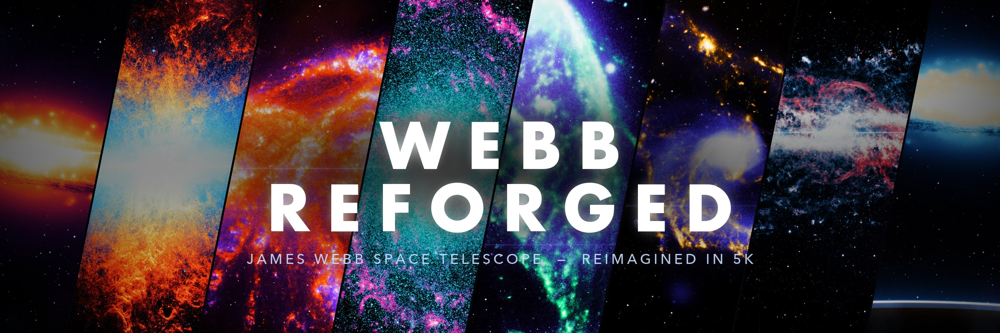

<br>

**Turn raw James Webb Space Telescope images into cinematic 5K desktop wallpapers.**<br>
<sub>No AI, no Photoshop. ~750 lines of NumPy + OpenCV that declutter, recolour, relight and re-sky real Webb data.</sub>

<br>

[](#-quick-start)
[](#-how-it-works)
[](https://github.com/Deeptanshuu/webb-reforged/releases/latest)
[](LICENSE)

[**Gallery**](#-gallery) · [**Before / After**](#-before--after) · [**How it works**](#-how-it-works) · [**Quick start**](#-quick-start) · [**Make your own**](#-make-your-own-preset) · [**Credits**](#-credits)

</div>

---

## ✦ Gallery

> Full-resolution **5120 × 2880** files are attached to the [latest release](https://github.com/Deeptanshuu/webb-reforged/releases/latest).

<table>
<tr>
<td width="50%">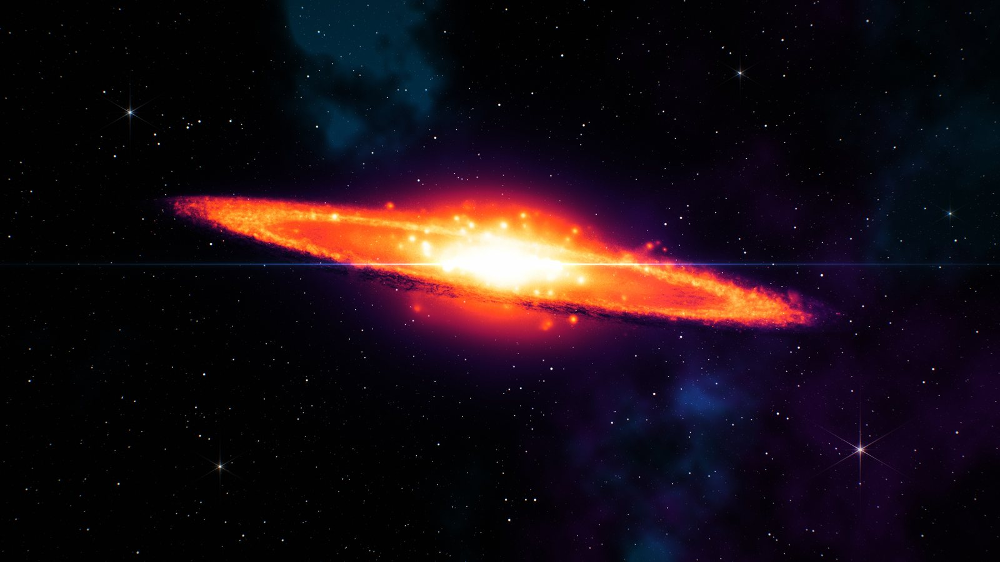<br><b>Inferno</b> · Sombrero Galaxy (M104)<br><sub><code>ember</code> · tilted, re-skied</sub></td>
<td width="50%">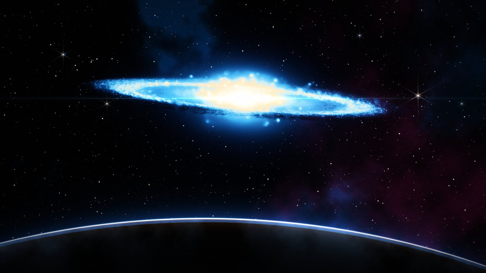<br><b>Horizon</b> · Sombrero Galaxy (M104)<br><sub><code>glacier</code> · seen from orbit</sub></td>
</tr>
<tr>
<td>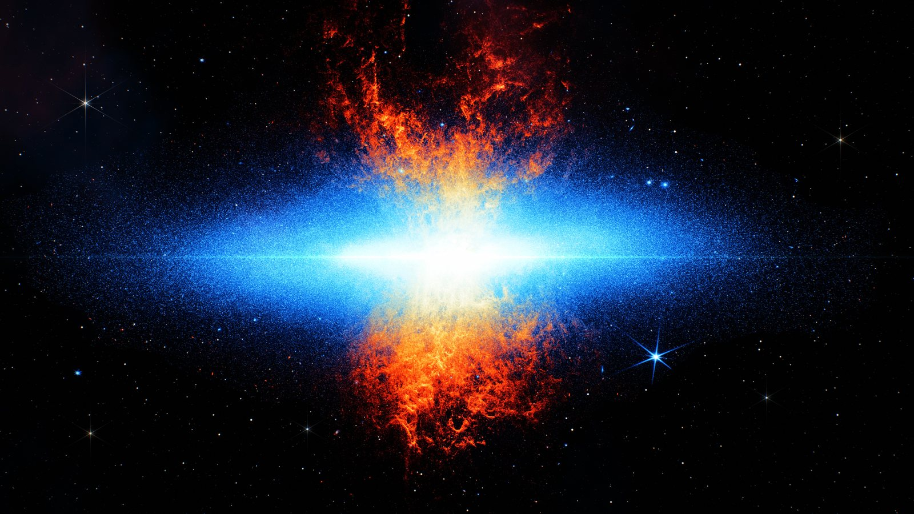<br><b>Solar Flare</b> · Cigar Galaxy (M82)<br><sub><code>electric</code> × <code>fire</code></sub></td>
<td>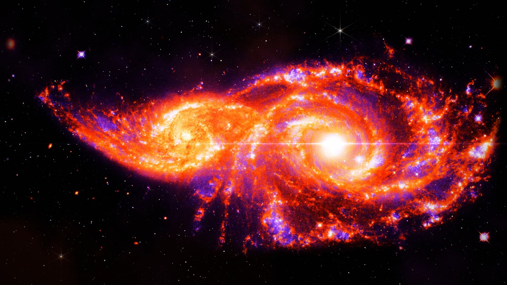<br><b>Molten</b> · IC 2163 & NGC 2207<br><sub><code>violet</code> × <code>lava</code></sub></td>
</tr>
<tr>
<td>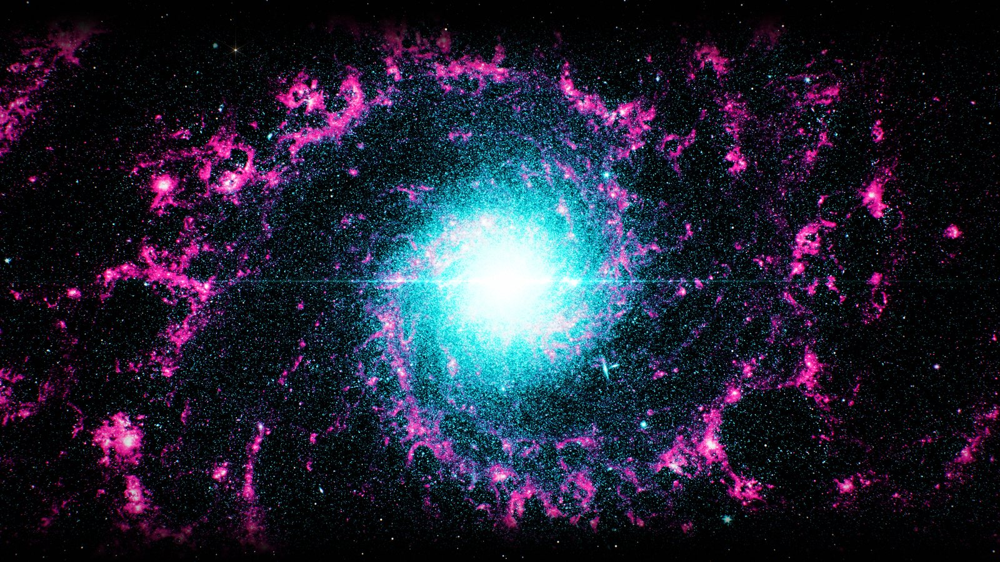<br><b>Neon Vortex</b> · Phantom Galaxy (M74)<br><sub><code>cyan</code> × <code>magenta</code></sub></td>
<td>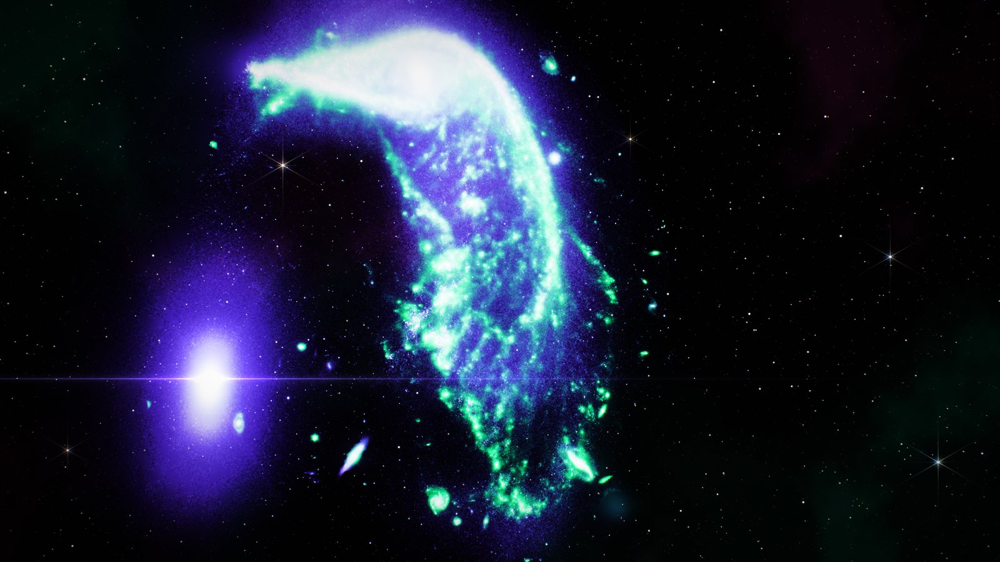<br><b>Aurora</b> · the Penguin & the Egg (Arp 142)<br><sub><code>indigo</code> × <code>aurora</code></sub></td>
</tr>
<tr>
<td><br><b>Gold Leaf</b> · Arp 107<br><sub><code>sapphire</code> × <code>gold</code></sub></td>
<td>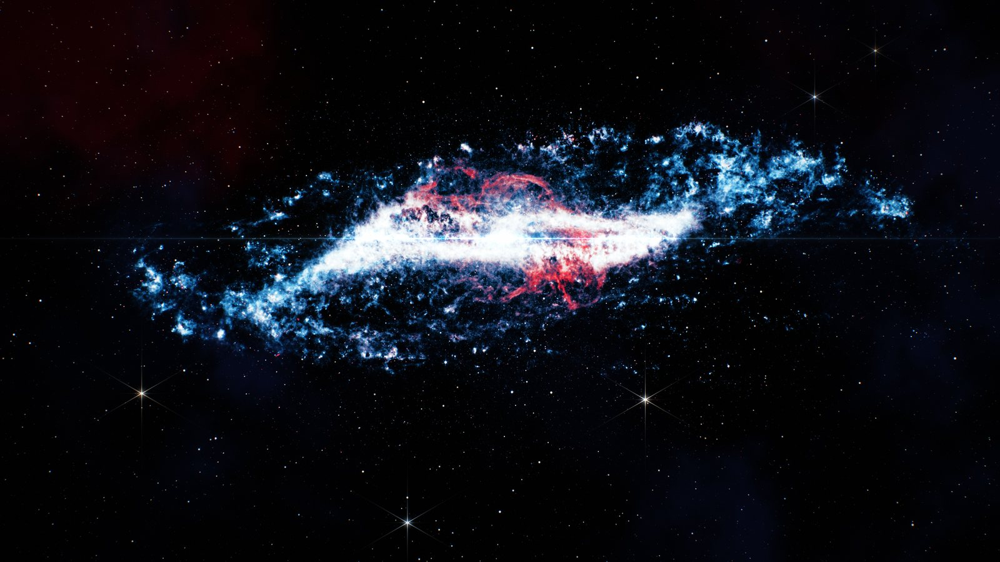<br><b>Crimson Eclipse</b> · Centaurus A<br><sub><code>frost</code> × <code>crimson</code></sub></td>
</tr>
</table>

## ⇄ Before / After

Webb composites are breathtaking, but as wallpapers they have two problems: the sky is
**full of tiny background galaxies** (confetti-coloured dots everywhere), and the colours come
from **filter assignments**, not art direction. Every image here starts as the real data on
the left.

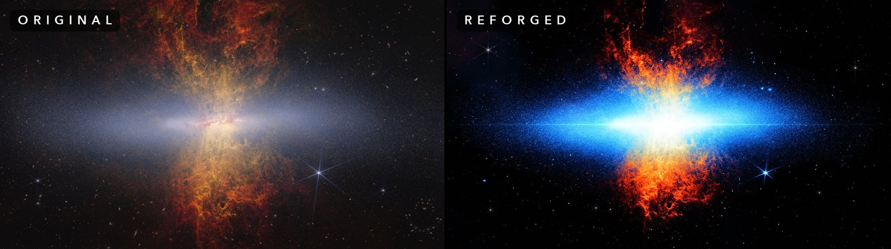
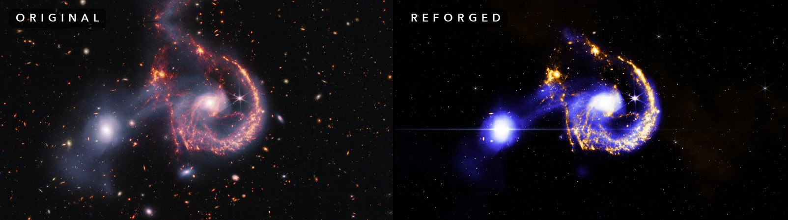
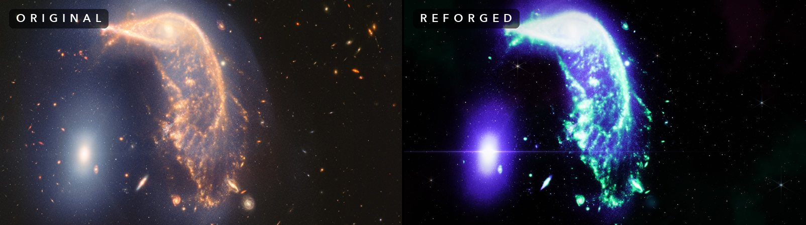
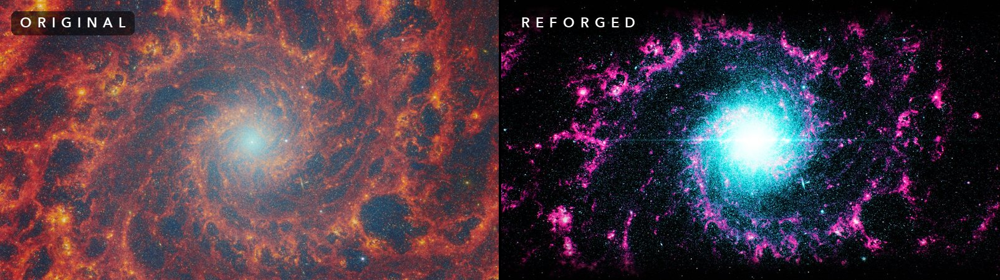

<details>
<summary><b>More comparisons</b></summary>
<br>
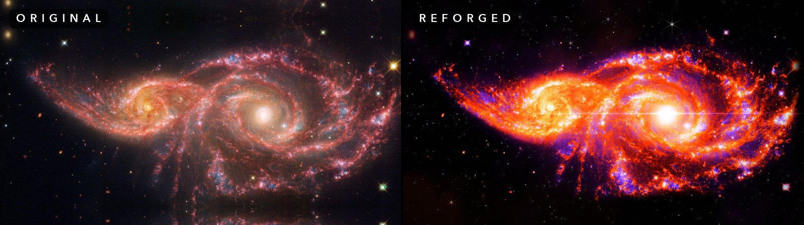
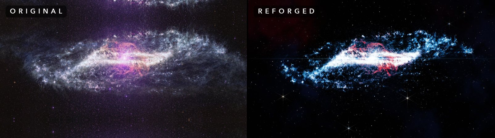
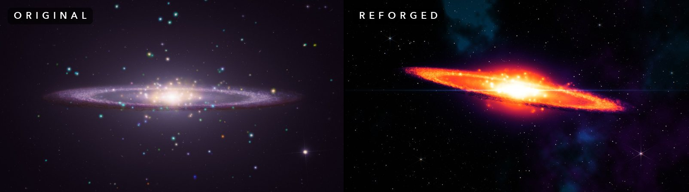
</details>

## ⚙ How it works

Every preset runs the same six-stage pipeline. Each stage is a plain function over
`float32` BGR arrays, so you can dump them all with `--stages` and see exactly what happened.

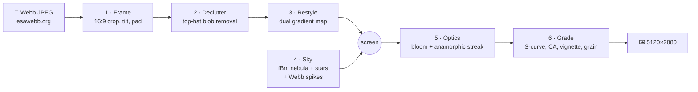

<table>
<tr>
<td width="33%">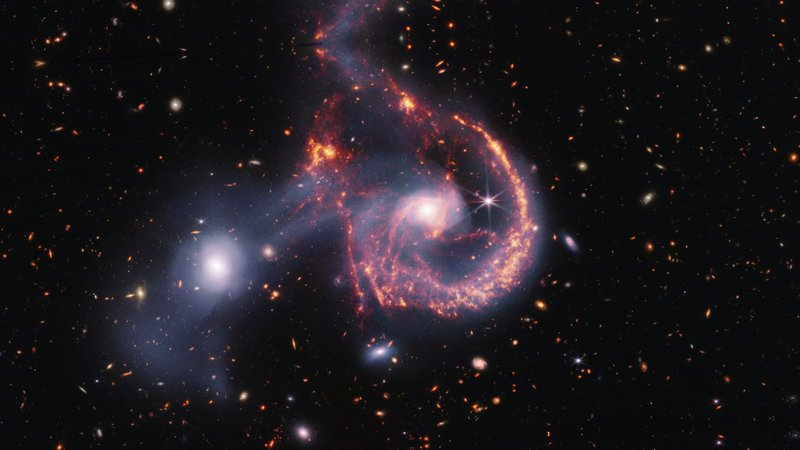<br><b>1 · Frame</b></td>
<td width="33%">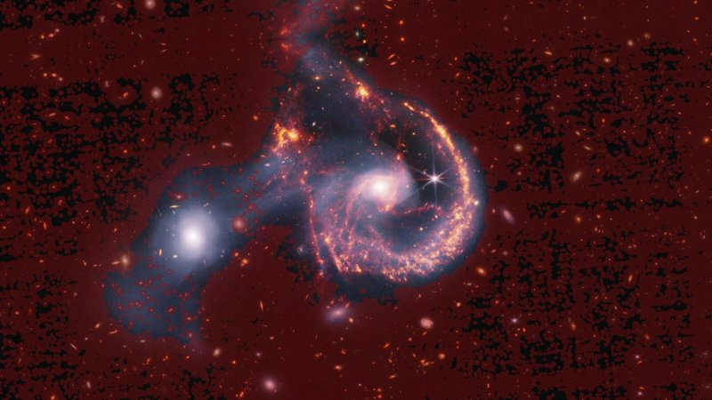<br><b>2 · Find clutter</b> <sub>(red = painted out)</sub></td>
<td width="33%">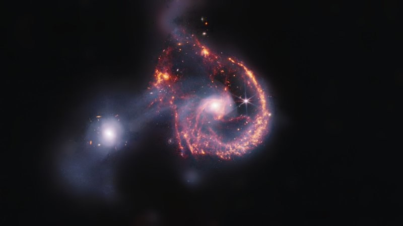<br><b>2 · Declutter</b></td>
</tr>
<tr>
<td>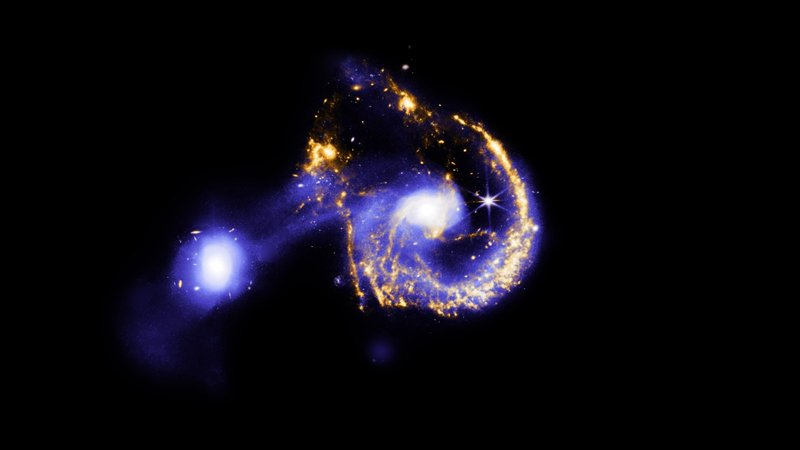<br><b>3 · Restyle</b></td>
<td>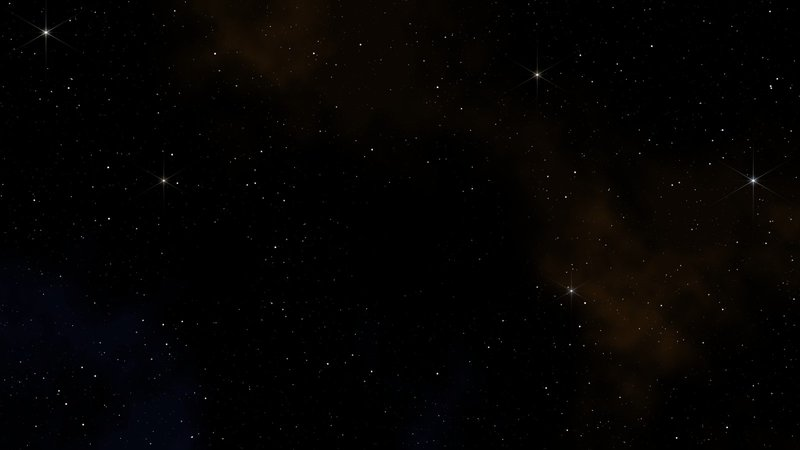<br><b>4 · Generated sky</b></td>
<td>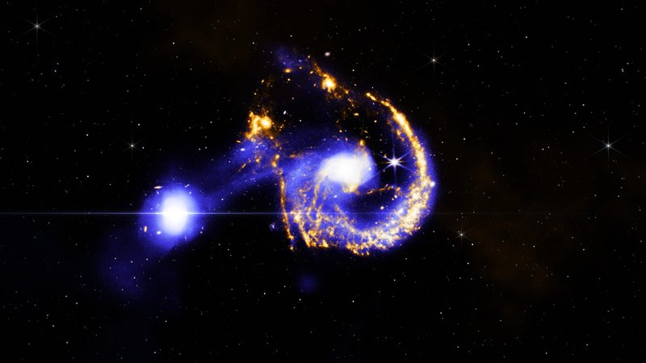<br><b>5–6 · Optics + grade</b></td>
</tr>
</table>

### 1 · Frame
The source is scaled, rotated and positioned so a chosen point lands mid-frame. `cover`
fills the 16:9 frame; `width` fits the whole galaxy and pads with generated sky, behind a
feathered alpha, so you never see the edge of the original.

### 2 · Declutter: deleting the confetti
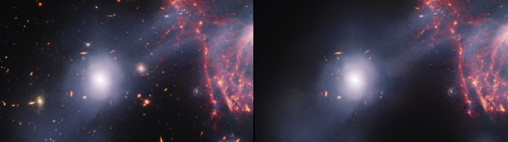

A **morphological top-hat** (image minus its opening with a ~60 px disk) keeps only things
*smaller* than the disk and brighter than their surroundings: stars and distant galaxies,
not the galaxy itself. It runs on luminance **and** on chroma (`max − min` of RGB), so
saturated orange specks get caught even when they're dim.

```python
top  = cv2.morphologyEx(lum,    cv2.MORPH_TOPHAT, disk)
ctop = cv2.morphologyEx(chroma, cv2.MORPH_TOPHAT, disk)
blobs = (np.maximum(top, 1.2 * ctop) > 0.022) & (large_scale_light < sky_t)
```

Three details made this work in practice:

- **Detect at a fixed 1080p.** At 5K, sky noise bridges neighbouring blobs into giant
  connected regions that fail the *small and compact* test, so nothing gets removed.
  Downsampling first averages the noise away. The mask is then scaled back up.
- **Per-blob ellipse stamps.** Each blob is covered by an ellipse about 1.6× its bounding box.
  Plain dilation leaves faint rings around the bigger galaxies.
- **Protect zones.** Star-forming knots in a galaxy's arms look *exactly* like background
  galaxies. Presets can fence off the real structure with ellipses. Outside them, strong
  blobs are removed even when they sit on a bright halo.

Removed blobs are filled from a dot-free model of the local light (a median-filtered 1/24
thumbnail, upsampled).

### 3 · Restyle: the dual gradient map
This is where the look comes from. Each pixel's **luminance** picks a position along a
palette (black → colour → white, so no tonal detail is lost), and its **warmth**
`(R − B) / (R + G + B)` blends between a *cool* and a *warm* palette. The image keeps its
own warm/cool structure, such as M82's blue disk against its orange plumes, but every colour
now comes from two hand-picked ramps.

```python
t     = ((lum - sky) / (white - sky)).clip(0, 1) ** gamma
warm  = smoothstep((warmth - pivot) / span + 0.5)
color = gradient_map(t, cool_pal) * (1 - warm) + gradient_map(t, warm_pal) * warm
```

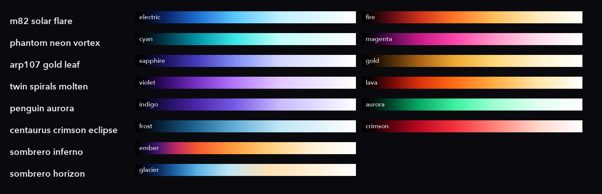

### 4 · Sky
- **Nebula:** two fractal-noise (fBm) fields, *domain-warped* by two more noise fields so
  they curl like gas, then cut with dark dust filaments from a fifth.
- **Starfield:** three tiers (fine dust, mid-field and a few bright stars) with a power-law
  brightness spread and stellar colours from K-type gold to O/B blue-white.
- **Webb diffraction stars:** six spikes at 90°/30°/150° from JWST's hexagonal mirror
  segments, plus the faint horizontal pair from the secondary-mirror strut. They're placed
  only where the galaxy is dark.

Stars are dimmed by the subject's brightness, so they sit *behind* the galaxy. The subject
is then **screen**-blended on top, which adds light the way a projector would.

### 5–6 · Optics & grade
Three-radius **bloom** (tight halo, soft glow, wide haze) · a hair-thin **anamorphic streak**
through the core, tinted from the cool palette · filmic **S-curve** and saturation lift ·
radial **chromatic aberration** · **vignette** · fine **grain**.

### The Sombrero hero pipeline
<table><tr>
<td width="50%">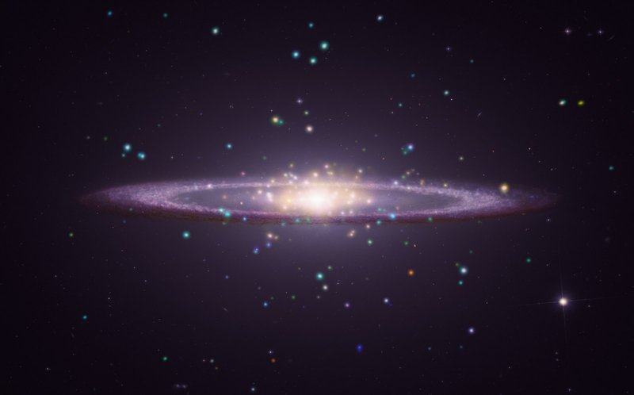<br><sub>input</sub></td>
<td width="50%">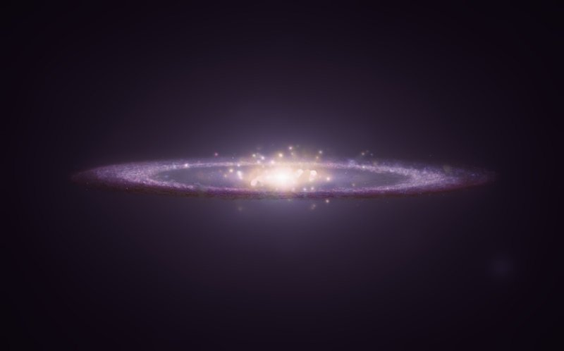<br><sub>cleaned layer</sub></td>
</tr></table>

The two Sombrero pieces go further and **rebuild** the scene. Inside the disk, the stray
dots are found by **hue** (the disk is purple, so green is its weakest channel, while every
cyan/green/yellow dot has green well above `min(R, B)`). Each dot is repaired by **cloning
real dust-lane texture** from a sideways offset along the disk, with its low frequencies
matched to a Telea inpaint. Plain inpainting left flat smudges. Everything outside the
disk becomes a smooth halo. The cleaned layer is then gradient-mapped, tilted and dropped
onto a fresh sky, or above a procedural **planet** with a cloud-banded night side and a
glowing atmospheric limb.

## ▶ Quick start

```bash
git clone https://github.com/Deeptanshuu/webb-reforged && cd webb-reforged
uv venv && uv pip install -e .        # or: python -m venv .venv && pip install -e .

reforge fetch                          # ~87 MB of originals from esawebb.org → originals/
reforge render                         # all presets → out/*_5k.jpg  (~12 s each)
```

```bash
reforge list                                   # presets and their sources
reforge render m82_solar_flare --width 3840    # one preset, 4K
reforge render arp107_gold_leaf --stages stages # dump every pipeline stage
reforge sombrero my_edge_on_galaxy.jpg --variant horizon
reforge palettes --out palettes.png
```

## ✎ Make your own preset

Grab any image ID from [esawebb.org/images](https://esawebb.org/images/) and add a `Preset`
to [`reforge/presets.py`](reforge/presets.py):

```python
Preset(
    name="cartwheel_toxic", title="Toxic — Cartwheel Galaxy", source_id="weic2211a",
    credit="NASA, ESA, CSA, STScI",
    centre=(0.48, 0.5), angle=-5,           # what lands mid-frame, and the tilt
    sky_t=0.12,                             # how aggressively to clear the sky
    cool_pal="indigo", warm_pal="aurora",   # any two names from reforge/palettes.py
    warm=(0.1, 0.35), gamma=1.2,
    nebula=0.3, flare=(0.48, 0.5), seed=9,
)
```

Then run `reforge fetch cartwheel_toxic && reforge render cartwheel_toxic --stages stages`
and tune from the stage dumps. New palettes are just lists of `(position, (R, G, B))` stops.

## ▤ Project layout

```
reforge/
├── cli.py         reforge fetch | render | sombrero | palettes | list
├── presets.py     one dataclass per wallpaper: framing, palettes, sky, flare
├── pipeline.py    frame → declutter → restyle → sky → optics → grade
├── declutter.py   top-hat blob detection, protect zones, paint-out
├── palettes.py    gradient-map palettes + gradient_map()
├── sky.py         fBm noise, domain-warped nebulae, starfield, Webb spikes
├── optics.py      screen, bloom, anamorphic streak, grade, CA, vignette, grain
└── sombrero.py    hero pipeline: texture-cloning cleanup + planet horizon
```

## ★ Credits

All source imagery comes from the **NASA/ESA/CSA James Webb Space Telescope** via
[ESA/Webb](https://esawebb.org/copyright/) under **CC BY 4.0**. The wallpapers are
artistic reinterpretations, **not scientifically accurate** representations. Colours,
stars, nebulae and the planet are invented.

| Wallpaper | Source | Credit |
|---|---|---|
| Solar Flare | [weic2612a](https://esawebb.org/images/weic2612a/) | NASA, ESA, CSA, A. Smercina (STScI), T. Williams (Univ. of Manchester), A. Pagan (STScI) |
| Neon Vortex | [potm2410a](https://esawebb.org/images/potm2410a/) | ESA/Webb, NASA & CSA, A. Adamo (Stockholm University) and the FEAST JWST team |
| Gold Leaf | [weic2423a](https://esawebb.org/images/weic2423a/) | NASA, ESA, CSA, STScI |
| Molten | [weic2426a](https://esawebb.org/images/weic2426a/) | NASA, ESA, CSA, STScI |
| Aurora | [weic2420a](https://esawebb.org/images/weic2420a/) | NASA, ESA, CSA, STScI |
| Crimson Eclipse | [weic2615a](https://esawebb.org/images/weic2615a/) | NASA, ESA, CSA, STScI, A. Pagan, J. DePasquale, M. García Marín |
| Inferno, Horizon | Sombrero Galaxy (M104), Webb NIRCam | NASA, ESA, CSA, STScI |

**Code:** [MIT](LICENSE). **Wallpapers:** CC BY 4.0, so please keep the credit line above
if you share them.

<div align="center"><br><sub>made with ☕, NumPy and a lot of staring at galaxies</sub></div>
